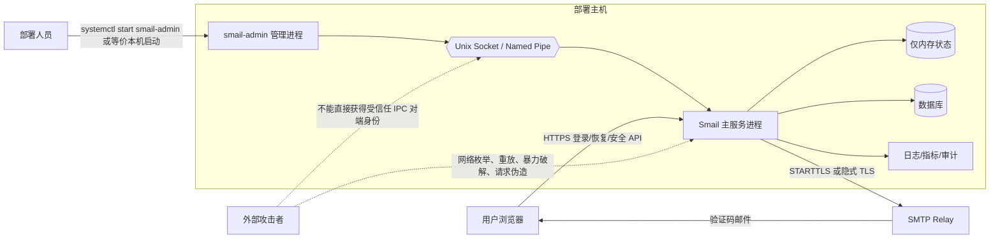

# Smail 安全威胁模型与敏感数据流设计

> 文档编号：AD-003
>
> 编写日期：2026-08-27
>
> 适用范围：Smail 认证服务、密码恢复、登录二次验证、外部安全邮箱、WebAuthn、离线恢复码，以及 `smail-admin` 本机超级管理员重置通道。
>
> 当前结论：本设计已经说明认证和重置链路中的敏感数据流、信任边界、持久化点、控制措施和负向测试。仍未替代 Ubuntu、Windows、SMTP Relay 和生产部署环境的最终验收；这些项目由 AD-011、AD-015、AD-034、AD-060～AD-066 继续负责。

## 1. 设计目标和安全结论

### 1.1 设计目标

本文件用于回答以下问题：

1. 哪些主体可以发起登录、验证码、恢复和超级管理员重置；
2. 密码、验证码、恢复票据、外部邮箱、WebAuthn 凭据和 IPC 请求分别经过哪些进程、内存结构、数据库表和外部服务；
3. 每个信任边界上的攻击面是什么；
4. 每项威胁至少对应一个控制措施和一个负向测试；
5. 是否存在未说明的敏感数据持久化点或网络重置入口。

### 1.2 当前安全结论

- 超级管理员自身的密码重置只有部署端本机 IPC 链路，HTTP 路由不提供该能力；`smail-admin` 不直接访问数据库。
- Linux 使用权限受限的 Unix Domain Socket 和对端 UID 校验；Windows 使用安全描述符限制的 Named Pipe，并校验客户端进程令牌是否为 SYSTEM 或提升后的管理员。
- IPC 使用一次性 nonce、有效期、单帧大小上限、协议版本和未知字段拒绝；nonce 在消费时原子删除，不能跨连接复用。
- 邮箱验证码只保存在签发认证进程内存，验证码只以 HMAC-SHA-256 校验值保存；进程重启后内存任务和临时密钥失效。
- 验证码按用途、账号、邮箱、资源、浏览器恢复上下文和必要的凭据版本绑定；同账号同用途重新签发会使旧任务失效。
- 验证码、恢复票据、WebAuthn ceremony 会话和登录二次验证状态均有容量上限、过期时间和一次性消费控制。
- 外部邮箱在数据库中保存 AEAD 加密密文和独立 HMAC 指纹；业务返回只使用脱敏邮箱，检索使用指纹，不以明文邮箱作为索引。
- 密码和密保答案使用 Argon2id 哈希；离线恢复码只保存 Argon2id 哈希，WebAuthn 凭据材料使用独立凭据密钥保护。
- `verification_rate_limit` 和 `verification_event` 只保存哈希后的运营维度；事件按保留类别清理，调查保留记录不会被自动删除。
- 当前文档明确列出的持久化点之外，不允许把验证码、验证码 HMAC、恢复票据、恢复码原文、IPC 密码、临时密钥或完整外部邮箱写入数据库、文件、日志、指标、追踪或浏览器存储。

## 2. 主体、组件和信任边界

| 编号 | 主体或组件 | 边界 | 可接触的数据 | 不应获得的数据 |
|---|---|---|---|---|
| A1 | 用户浏览器 | 外部网络与 HTTP 边界 | 用户输入、脱敏邮箱、临时恢复上下文 Cookie、HTTP 响应 | 服务端密码哈希、验证码 HMAC、完整外部邮箱、恢复票据明文 |
| A2 | 普通用户、管理员、超级管理员 | 业务授权边界 | 自身业务数据和被授权的安全操作 | 越权账号的凭据和恢复材料 |
| A3 | `Smail` 主服务进程 | 主服务进程边界 | HTTP 请求、认证状态、短时验证码和恢复状态、数据库密钥解密后的短暂明文 | 不应向插件、日志和诊断接口导出临时密钥或验证码 |
| A4 | `smail-admin` 管理进程 | 管理进程与本机 IPC 边界 | 交互输入的新密码、IPC nonce、结果状态 | 数据库连接、其他用户密码、长期维护凭据 |
| A5 | SMTP Relay 或本机 SMTP 服务 | 主服务与外部投递边界 | 收件地址、邮件正文中的验证码、SMTP 认证材料 | 主服务内存索引、恢复票据、数据库密钥 |
| A6 | 数据库 | 主服务与持久化边界 | 用户密码哈希、加密邮箱、凭据哈希/密文、哈希运营维度、会话数据 | 验证码原文、验证 HMAC、恢复票据原文、IPC 密码 |
| A7 | 操作系统和服务管理器 | 主机权限边界 | 文件权限、服务身份、进程身份、IPC 对端凭据 | 通过普通 Web 请求触发部署端重置 |
| A8 | 日志、指标、追踪和审计系统 | 观测边界 | 稳定错误、非敏感事件类型、哈希维度和脱敏状态 | 密码、验证码、完整邮箱、恢复码、票据、临时密钥和 IPC 内容 |

### 2.1 信任边界图

### 2.2 进程边界和默认假设

- `Smail` 主服务进程是唯一执行密码哈希、数据库写入和凭据撤销的业务进程。
- `smail-admin` 是短时管理客户端，只通过本机 IPC 传输一次密码重置请求；它不加载数据库配置，也不执行 SQL。
- SMTP Relay 是不受 Smail 进程控制的外部组件，必须按网络和凭据泄露风险对待；远程明文 SMTP 被配置校验拒绝。
- 数据库属于受部署权限保护的持久化边界，但数据库管理员或备份读取者不应因此获得验证码原文、恢复码原文或 IPC 密码。
- 浏览器、插件、普通日志查看者和普通管理 API 都属于不可信或低信任边界，不得接收完整邮箱和可直接验证的秘密。

## 3. 敏感数据分类与生命周期

| 数据 | 产生位置 | 允许的短暂流转 | 允许的持久化形式 | 生命周期和销毁 |
|---|---|---|---|---|
| 登录密码、新密码 | 浏览器或 `smail-admin` 交互输入 | HTTPS 请求体或本机 IPC 帧；主服务哈希过程 | 仅 Argon2id 密码哈希 | 请求完成后覆盖局部缓冲；旧会话通过 `session_version` 失效 |
| 邮箱验证码原文 | `verification.Store.Issue` | 生成、构造邮件、SMTP 投递、HMAC 计算 | 禁止落库、落文件、入日志和指标 | `defer clearString`、邮件字节清理、验证成功/过期/超限删除 |
| 验证码 HMAC | `verification.Store` | 仅主服务内存校验 | 禁止持久化 | 随挑战删除；进程退出丢失 |
| 验证码 ID | 主服务内存和 HTTP 响应 | 浏览器提交到验证接口 | 不作为可恢复凭据持久化 | 挑战消费、过期、重发或用户失效时删除 |
| 恢复票据 | `recovery.Service` | 验证成功到完成改密的 HTTP 流程 | 仅内存保存票据摘要及绑定元数据 | 五分钟过期；完成或失败时删除；进程重启失效 |
| 恢复码原文 | 管理页面或恢复输入 | 生成后一次性响应、验证时短暂进入服务 | 仅 Argon2id 哈希 | 生成接口只显示一次；消费、撤销或密码重置后失效 |
| 密保答案 | 管理页面或恢复输入 | 哈希验证过程 | 仅 Argon2id 哈希 | 改密或统一凭据撤销时删除问题记录 |
| 外部安全邮箱 | 绑定/登录/恢复服务 | 解密后用于匹配、投递和脱敏返回 | AES-GCM 加密密文 + 独立 HMAC 指纹 | 未验证绑定失败回滚；停用后不可用于认证；解密明文只短暂存在 |
| WebAuthn 凭据 | 浏览器 ceremony | WebAuthn 请求和服务端验证 | 独立凭据密钥保护的序列化凭据 | ceremony 会话限时一次；凭据可撤销；恢复或重置按权限撤销 |
| 登录二次验证状态 | `loginVerificationState` 和验证码 Store | 登录密码成功后到验证码验证完成 | 仅内存 | 十分钟过期、成功消费、密码/会话版本变化时删除 |
| IPC nonce | `SessionGuard` | 管理进程和主服务之间一轮连接 | 仅内存 | 两分钟默认有效；消费、断开或过期删除 |
| SMTP 认证密码 | 配置装载到 SMTP 投递 | SMTP 建连和认证 | 受配置 Secret 管理约束，不进入验证码事件 | 由配置 Secret 生命周期管理；不得进入邮件正文、日志或响应 |
| 临时进程密钥 | 验证码 Store、邮箱 Vault、审计指纹服务 | 进程内加密、HMAC 和校验 | 验证码临时密钥禁止持久化；外部邮箱和审计密钥按密钥管理策略保存 | 进程退出后验证码密钥失效；其他密钥不得通过诊断导出 |

## 4. 关键数据流

### 4.1 部署端超级管理员重置

1. 部署人员在受控主机上按正式部署命令启动 `smail-admin`，新密码从无回显安全交互读取，不通过命令行参数、环境变量、服务名或普通文件传递。
2. `smail-admin` 连接固定本机 IPC 地址：Linux 为 Unix Domain Socket，Windows 为 Named Pipe。
3. 主服务先校验对端身份，再签发一次性 nonce；客户端只能在当前连接返回同一 nonce 和新密码。
4. 主服务校验协议版本、单帧大小、字段集合、密码长度、nonce 一致性和 nonce 未过期/未消费。
5. 主服务在同一数据库事务中定位唯一超级管理员、更新 Argon2id 密码哈希、递增 `session_version`、撤销其恢复凭据，然后提交事务。
6. 提交成功后仅在内存中撤销该用户的会话、验证码、恢复票据和 WebAuthn 状态；客户端获得不含数据库细节的结果。

明确禁止：HTTP 路由、浏览器页面、远程 TCP、离线恢复码或外部邮箱验证码触发超级管理员自身重置。

### 4.2 外部安全邮箱绑定

1. 已登录用户提交待绑定邮箱；主服务规范化地址，生成密文和指纹，创建 `pending` 绑定。
2. 验证码服务生成随机验证码和挑战 ID，只在内存保存 HMAC 及绑定资源 ID；邮件服务构造正文并通过受保护 SMTP 投递。
3. 投递失败时删除本次 `pending` 绑定和对应挑战，避免留下不可完成的部分状态。
4. 用户提交挑战 ID、邮箱、验证码和绑定 ID；服务验证账号、用途、邮箱和资源 ID 后原子消费挑战。
5. 挑战消费成功后，绑定状态改为 `verified`；外部邮箱后续可用于登录二次验证和密码恢复。

### 4.3 登录二次验证

1. 登录请求先完成账号和密码校验，但在策略要求二次验证时不创建完整会话。
2. 主服务解密已验证的主要外部邮箱，仅用于本次邮件投递，并向客户端返回脱敏地址和挑战 ID。
3. 验证接口校验挑战、账号、用途和会话版本；成功后删除内存状态，再创建完整 Session。
4. 挑战过期、错误次数超限、用户被禁用、会话版本变化或用户凭据被撤销时，流程拒绝并清理状态。

### 4.4 邮箱密码恢复

1. 公开恢复入口首先检查功能开关、部署状态和合法访问主机。
2. 对不存在账号、错误邮箱、超级管理员或内部错误使用等形状的诱饵挑战，避免通过响应状态、字段形状或耗时可靠枚举账号。
3. 对有效用户，仅允许已验证且仍启用的外部邮箱；挑战绑定账号、邮箱、用途、外部邮箱资源 ID、凭据版本和恢复浏览器上下文。
4. 验证成功后签发五分钟恢复票据，票据只在内存保存摘要和最小绑定元数据；不把票据原文写入数据库。
5. 完成改密时重新检查用户角色、禁用状态、`session_version`、邮箱凭据版本和浏览器上下文，原子更新密码并递增会话版本。
6. 改密成功后撤销该用户的恢复票据、验证码、离线恢复凭据和相关登录验证状态。

超级管理员在第 3 步始终返回不可区分的拒绝结果，不进入 Web 恢复流程。

### 4.5 WebAuthn 注册和恢复

1. 注册和恢复先创建有类型、有用户绑定或发现式登录约束的 ceremony 会话。
2. 会话只在内存保存，具有容量上限、过期时间和一次性消费规则；凭据材料只在服务端验证后写入加密凭据数据。
3. 恢复验证成功只签发短时恢复票据，不直接创建完整登录 Session。
4. 完成改密时再次检查用户状态、会话版本和票据上下文；改密后清理目标用户的安全流程状态。

### 4.6 SMTP 投递

1. 验证码服务将验证码原文传给 SMTP Delivery，构造 `From`、`To`、主题和正文。
2. 远程 SMTP 只允许 STARTTLS 或隐式 TLS；纯文本 SMTP 只允许回环地址。
3. 如配置 SMTP 用户名，则通过 SMTP 认证连接 Relay；认证密码不写入验证码事件、响应和邮件正文。
4. 投递函数返回后尽最大努力清理邮件字节；投递失败由上游删除挑战或待绑定记录。

### 4.7 运营事件和限流

1. 验证码签发、验证、阻断等动作只记录用途、动作、结果、用户 ID 和账号/邮箱/IP 的 HMAC 指纹。
2. 限流器按账号、邮箱、IP、用户、用途、浏览器事务、环境和凭据版本构造哈希维度键，并在数据库事务中原子更新计数。
3. 限流记录和运营事件都带过期时间；清理器通过数据库租约保证同一环境只有一个清理者。
4. 事件查询和诊断不得返回挑战、HMAC、完整账号、完整邮箱、IP 明文或临时密钥。

## 5. 持久化点清单

| 持久化点 | 保存内容 | 允许用途 | 明确禁止 |
|---|---|---|---|
| `user.password` | Argon2id 密码哈希 | 登录和密码更新 | 密码原文、可逆密码密文 |
| `user.session_version` | 会话版本整数 | 旧会话和恢复票据失效 | 以版本字段替代权限校验 |
| `sessions` | 服务端会话不透明数据及过期时间 | HTTP 会话 | 将验证码或恢复票据放入浏览器可读数据 |
| `external_email` | 邮箱 AEAD 密文、独立指纹、类型、状态和凭据版本 | 已验证邮箱匹配、投递和恢复绑定 | 邮箱明文、把指纹当作可验证凭据 |
| `security_question` | 问题文本、答案 Argon2id 哈希、版本 | 已登录用户配置和恢复校验 | 答案原文 |
| `recovery_code` | 恢复码 Argon2id 哈希、版本、消费时间 | 一次性离线恢复 | 恢复码原文、可逆密文 |
| `webauthn_credential` | 凭据 ID、加密凭据数据、显示名、生命周期字段 | WebAuthn 验证和撤销 | 未保护的私密材料或跨用户凭据 |
| `verification_rate_limit` | 哈希维度键、维度类型、计数、时间窗口 | 跨进程限流和清理 | 账号、邮箱、IP、验证码和票据原文 |
| `verification_event` | 用途、动作、结果、哈希维度、保留策略 | 脱敏运营审计 | 密码、验证码、挑战值、完整邮箱、IP 明文 |
| `verification_cleanup_state` | 清理租约、下次执行时间和失败计数 | 单实例清理协调 | 将租约当作业务认证凭据 |
| 配置 Secret 存储 | SMTP、外部邮箱和其他配置密钥的受控 Secret | 服务启动和加解密 | 通过通用配置响应、日志或指标暴露 |

以下内容**不允许持久化**：验证码原文、验证码 HMAC、验证码挑战上下文、恢复票据原文、IPC nonce、IPC 新密码、恢复码原文、密保答案、SMTP 认证密码副本、WebAuthn 私密材料明文、邮箱解密后的明文、验证码临时进程密钥。

## 6. 威胁、控制措施和负向测试矩阵

| 编号 | 威胁场景 | 控制措施 | 负向测试或证据 |
|---|---|---|---|
| T-01 | 本机普通用户冒用部署端重置 | 固定本机 IPC；Linux 校验 Unix 对端 UID、目录和 Socket 权限；Windows 校验 SYSTEM/提升管理员令牌 | `adminreset.TestAuthorizeLinuxProcessRequiresSystemdInvocation`；`adminreset.TestWindowsPipeACLOnlyNamesSystemAndAdministrators` |
| T-02 | 伪造或跨进程冒用 IPC 会话 | nonce 由服务端签发，必须在同一连接返回；拒绝未知字段和错误协议 | `adminreset.TestProtocolRejectsUnknownFieldsInvalidVersionAndTrailingData`；`adminreset.TestWindowsNamedPipeRejectsNonceFromAnotherConnection` |
| T-03 | 重放已成功的重置请求 | `SessionGuard.Consume` 原子删除 nonce；连接关闭或失败时丢弃；短 TTL | `adminreset.TestSessionGuardRequiresIssuedNonceAndConsumesOnce`；`adminreset.TestSessionGuardRejectsExpiredNonce` |
| T-04 | 通过恢复接口枚举账号、邮箱或超级管理员 | 诱饵挑战；统一响应状态和 JSON 形状；超级管理员不进入 Web 恢复；WebAuthn begin 忽略标识符 | `controllers.TestPasswordRecoveryBeginResponsesDoNotRevealAccountState`；`controllers.TestWebAuthnRecoveryBeginResponsesDoNotRevealAccountState`；`controllers.TestWebAuthnLoginBeginResponsesIgnoreIdentifier` |
| T-05 | 验证码暴力破解和邮件轰炸 | 每次挑战最多五次；账号、邮箱、IP、用途和事务多维限流；重发替换旧挑战 | `verification.TestStoreLimitsAttemptsAndExpires`；`verification.TestServiceAppliesIndependentAccountEmailAndIPLimits`；`verification.TestPersistentRateLimiterAppliesIPLimitAcrossIdentities` |
| T-06 | 恶意创建任务导致内存耗尽 | 验证码全局/每用户容量上限；恢复票据、诱饵挑战和 WebAuthn ceremony 上限；清理过期状态 | `verification.TestStoreLimitsAttemptsAndExpires`；`recovery.TestRecoveryStoresOnlyTicketDigestAndLimitsCapacity`；`webauthn.TestCeremonySessionCapacityAndExpiredPruning` |
| T-07 | SMTP 明文泄露、注入或远程无 TLS 投递 | 远程仅 STARTTLS/隐式 TLS；纯文本只允许回环；Host、From 和收件地址校验；邮件字节清理 | `verification.TestSMTPModesAreValidated`；`verification.TestSMTPHostValidation`；`verification.TestSMTPDeliveryKeepsCodeOutOfChallenge` |
| T-08 | 日志、审计、指标或诊断泄露秘密 | 敏感服务错误使用稳定中文消息；事件和限流仅记录 HMAC 指纹；不提供内存任务详情和临时密钥诊断 | `verification.TestEventStorePersistsOnlyOperationalFingerprintsAndCleansAfterRetention`；`verification.TestPersistentRateLimiterDoesNotPersistSensitiveValues`；`config.TestFileAuditWriterPersistsOnlyRedactedMetadata`（完整日志哨兵由 AD-004、AD-057 补齐） |
| T-09 | 并发双花：验证码、恢复票据、恢复码或 WebAuthn ceremony 被同时消费 | 内存锁下原子删除；数据库条件更新 `used_at IS NULL`；票据先摘除再改密；ceremony 类型不匹配也消费会话 | `recovery.TestRecoveryTicketConcurrentConsumptionHasOneWinner`；`webauthn.TestDiscoverableCeremonyIsConsumedOnceUnderConcurrency`；`credentials.TestRecoveryCodesAreShownOnceAndConsumedAtomically` |
| T-10 | 跨账号、跨用途、跨邮箱或跨浏览器上下文复用挑战 | HMAC 绑定账号、用途、邮箱、资源 ID；浏览器上下文只保存摘要；错误上下文不消费有效挑战 | `verification.TestServiceBindsVerificationToResource`；`verification.TestStoreRejectsDifferentBrowserContextWithoutConsumingChallenge`；`recovery.TestRecoveryBindsChallengeAndTicketToBrowserContext` |
| T-11 | 密码或邮箱凭据变更后继续使用旧恢复流程 | `session_version`、外部邮箱 `credential_version` 和统一 `InvalidateUser`；密码重置撤销恢复码、密保问题和 WebAuthn | `recovery.TestRecoveryTicketRejectsChangedSessionVersion`；`controllers.TestPasswordChangeRevokesOfflineCredentialsAtomically`；`adminreset.TestResetSuperAdminOnlyRevokesTargetSessionsAndCredentials` |
| T-12 | 恢复流程状态跳跃或直接调用完成接口 | begin/verify/complete 分离；complete 只接受服务端内存票据和浏览器上下文；无票据、过期票据和错误上下文拒绝 | `controllers.TestRecoveryBrowserContextCookieIsRequiredForCompletion`；`recovery.TestRecoveryRejectsCrossUserVerificationAndConsumesTicketOnce` |
| T-13 | 未验证、已停用或他人外部邮箱被用于恢复/登录 | 查询只接受 verified 状态；资源 ID 和 UserID 双重绑定；停用时失效验证码、恢复票据和登录状态 | `externalemail.TestRepositoryBindsVerifiesAndScopesByUser`；`externalemail.TestRepositoryAbandonsOnlyOwnedPendingBinding`；`backend/controllers/security.go` 中 `DisableExternalEmail` 的状态失效代码审查 |
| T-14 | 数据库读取者通过运营数据还原账号、邮箱或 IP | 运营字段使用独立 HMAC 指纹；限流维度键哈希；不保存完整值；按期限清理 | `verification.TestEventStorePersistsOnlyOperationalFingerprintsAndCleansAfterRetention`；`verification.TestPersistentRateLimiterDoesNotPersistSensitiveValues` |
| T-15 | 主服务重启后旧验证码或恢复流程被恢复使用 | 验证码 Store 的临时密钥和任务只在内存；恢复票据、诱饵挑战和 WebAuthn ceremony 不从数据库恢复 | `verification.TestStoreRestartInvalidatesAllChallenges`；`recovery.TestRecoveryStoresOnlyTicketDigestAndLimitsCapacity`；`webauthn.TestCeremonySessionCapacityAndExpiredPruning` |
| T-16 | 超级管理员通过 Web、外部邮箱或恢复码重置自身密码 | 恢复用户加载明确拒绝 `super_admin`；部署端重置单独走 IPC；没有 Web 路由调用 `ResetSuperAdmin` | `recovery.TestRecoveryDeniesSuperAdministrator`；`controllers.TestRecoveryRejectsWhenDisabled`；路由审计：`backend/listen/http_server/http_server.go` 未注册网络超级管理员重置入口 |
| T-17 | 恶意请求超过协议帧、JSON 或 SMTP 头字段限制 | IPC 最大帧 16 KiB、JSON unknown field 拒绝；邮箱和 SMTP Host/From 禁止换行和非法格式；HTTP JSON 单值解析 | `adminreset.TestProtocolRejectsOversizedFrame`；`controllers.TestDecodeJSONRequestRejectsUnsafeBodies`；`verification.TestSMTPHostValidation` |
| T-18 | 外部错误把数据库细节或秘密返回给调用方 | IPC 统一返回 `RESET_FAILED`；HTTP 使用稳定业务错误；日志只记录内部错误上下文，不拼接密码、验证码和完整邮箱 | `adminreset.TestWindowsNamedPipeReturnsSafeHandlerFailure`；`controllers.TestSecurityHandlersRejectUnauthenticatedRequests`；安全响应形状测试 |

## 7. 代码与测试映射

| 能力 | 主要代码 | 主要测试 |
|---|---|---|
| IPC 协议和 nonce | `backend/services/adminreset/protocol.go`、`client.go`、`transport_unix.go`、`transport_windows.go` | `backend/services/adminreset/protocol_test.go`、`transport_windows_test.go`、`doctor_linux_test.go` |
| 超级管理员事务 | `backend/services/adminreset/reset.go` | `backend/services/adminreset/reset_test.go` |
| 验证码内存仓库 | `backend/services/verification/store.go`、`service.go`、`runtime.go` | `store_test.go`、`service_test.go`、`cleanup_test.go` |
| SMTP 投递 | `backend/services/verification/delivery.go` | `delivery_test.go` |
| 限流和运营事件 | `backend/services/verification/rate_limit.go`、`event_store.go` | `rate_limit_test.go`、`event_store_test.go`、`event_cleanup_test.go` |
| 外部邮箱加密和生命周期 | `backend/services/externalemail/vault.go`、`repository.go` | `vault_test.go`、`repository_test.go` |
| 密保和离线恢复码 | `backend/services/credentials/service.go` | `service_test.go` |
| 密码恢复状态机 | `backend/services/recovery/service.go` | `service_test.go`、`webauthn_recovery_test.go` |
| 登录二次验证 | `backend/controllers/login_verification.go`、`login.go` | `login_security_test.go`、安全控制器测试 |
| WebAuthn ceremony | `backend/services/webauthn`、`backend/controllers/webauthn.go` | WebAuthn service tests、recovery WebAuthn tests |
| HTTP 公开边界 | `backend/controllers/security.go`、`backend/listen/http_server/http_server.go` | `security_reset_entry_test.go`、`security_public_response_test.go`、`security_authentication_test.go` |
| 密码重置后的状态失效 | `backend/controllers/security.go`、`backend/services/recovery`、`backend/services/adminreset` | `password_reset_permissions_test.go`、`reset_test.go`、recovery invalidation tests |

## 8. 已知边界、剩余风险和后续任务

1. **日志哨兵尚未集中化**：当前验证码事件和限流持久化已有敏感值负向测试，但全局日志、指标、追踪和错误报告仍需由 AD-004、AD-057、AD-059 建立统一字段白名单和哨兵扫描。
2. **真实平台 IPC 尚未完全验收**：Linux Ubuntu 22.04/24.04 的 systemd 一次性服务和 Windows 真实部署身份边界仍由 AD-011、AD-015、AD-062、AD-063 验证；单元测试不能替代真实部署。
3. **SMTP Relay 真实链路尚未完全验收**：STARTTLS/隐式 TLS 的握手、证书校验、认证失败回写和服务商日志需要 AD-034、AD-035、AD-038 的集成测试。
4. **多实例边界必须保持明确**：验证码挑战只存在于签发实例内存；部署多主实例时必须使用粘性路由或继续保持单实例，否则验证请求不能切换实例而不应通过持久化验证码绕过边界。
5. **内存清理是尽力而为**：Go 字符串复制和运行时调度无法提供绝对的零化保证，代码已在可控缓冲区使用覆盖，并以短 TTL、最小生命周期和进程权限降低暴露窗口。
6. **数据库备份和主机转储不属于业务恢复通道**：备份权限、磁盘加密、核心转储、交换分区、崩溃转储和日志收集必须由部署和运维基线单独控制，不得把它们当成 Web 恢复能力。

## 9. AD-003 验收清单

- [x] 已绘制部署端重置、验证码签发、SMTP 投递、验证消费、登录二次验证和密码恢复数据流；
- [x] 已标记外部主体、HTTP 边界、主服务进程、管理进程、IPC 边界、SMTP、数据库、内存和观测边界；
- [x] 已登记密码、验证码、HMAC、票据、恢复码、外部邮箱、WebAuthn、Session、限流和审计数据的生命周期；
- [x] 已覆盖本机提权、IPC 冒用、重放、账号枚举、验证码暴力破解、内存耗尽、SMTP 泄露、日志泄露和并发双花；
- [x] 每项威胁均对应控制措施和至少一个负向测试或明确的后续补齐任务；
- [x] 未发现未说明的敏感数据持久化点；
- [x] 未发现网络超级管理员密码重置入口；
- [ ] 真实 Ubuntu、Windows、SMTP Relay 和全局日志哨兵验收仍由后续任务负责。

## 10. 复审结论

AD-003 可标记为“已完成，等待复审”。该结论只表示设计、代码映射和现有自动化负向测试已经形成可追踪闭环，不表示后续平台部署、真实 SMTP、日志治理或最终发布验收已经完成。
